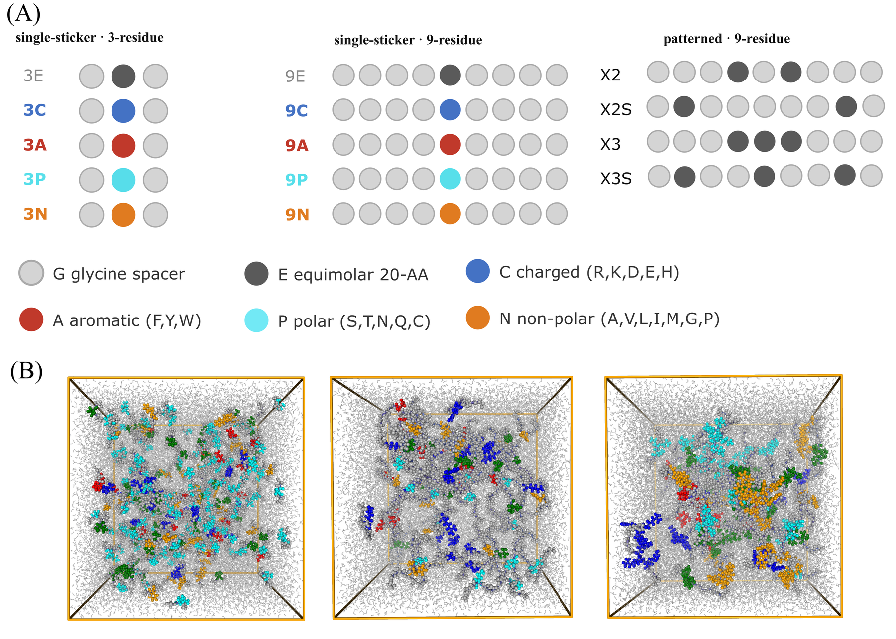

# GXG condensate analysis

<p align="center">
  
</p>
<p align="center"><em>(A) Sequence design of the 14 systems: single-sticker 3- and 9-residue peptides
and patterned 9-residue peptides. (B) Simulation snapshots of the condensates.</em></p>

Analysis and plotting code for molecular dynamics simulations of GXG peptide
condensates in explicit water. It covers condensate composition, water content
and dynamics, peptide contact networks, chain conformation, and the manuscript
figures.

Simulation inputs, trajectories and derived data are not included. The code
expects the lab project layout (`gxg-project/` containing `gxg_comps/`,
`vysakh_analysis/data/`, etc.). Several scripts and notebooks hardcode paths
under `/Volumes/potoyan-lab/will/gxg-project/`; edit those to point at your copy
of the data.

## Layout

```
new_plots/                        figure pipeline
  make_plots.py                   plots 01-06 (water content, lifetimes, survival collapse, biexp fits)
  src/
    sequences.py, descriptors.py  sequence definitions and sequence descriptors
    observables.py                per-system observables table
    main.py, main_2.py            descriptor vs observable correlation plots (07-09)
    contact_network.py            peptide contact networks from trajectories (slow)
    plot_network.py               network metrics and degree distributions (10-13)
    sticker_engagement.py         sticker engagement / diversification
    residue_pair.py               residue-pair contact enrichment
    chain_conformation.py         chain conformation statistics
    radial_profiles.py            radial density profiles from the condensate centre
    water_structure.py            water structure (g_OO, tetrahedral q)
    plot_*.py                     plotting for each analysis above
    figure1.py ... figure6.py     manuscript figures
    figure_si_convergence.py      SI convergence figure
    money_plot.py, render_snapshots.py

vysakh_analysis/
  40_ps_survival_analysis/        inner/outer water survival on a common 40 ps axis
    run_survival.py               survival probabilities for all systems (checkpointed)
    analyze_survival.py           fits and summaries
    run_water_structure.py        per-molecule water structure (H-bonds, coordination, q)
    make_figures.py
    src/                          layers (GITIM), survival, reorientation, systems
  fun_corr.py                     correlation-function helpers
  *.ipynb                         analysis notebooks (outputs stripped)

notebooks/                        system building and core condensate analysis (outputs stripped)
  make_system, peptide-maker,     build peptide sequences, mixtures and simulation systems
  mixture_maker.py, traj_merger
  cluster_analysis, clustering_*  condensate cluster identification and size analysis
  clustering_analysis.py
  Prolif_Analysis,                residue-residue contacts and interaction fingerprints
  get_contacts_analysis,
  Gly_vs_SideChain_Contacts
  waterbridge_analysis,           water-bridged contacts and heatmaps
  Heatmap_Maker
  hbonding_tests,                 hydrogen bonding and solvent coordination
  solvent_coordination
  RDF_calc, rdf-visualization     radial distribution functions
  MSD                             mean squared displacement
  slab_analysis.py                slab density profiles
  transformations.py              parsers for contact/interaction output files
  *visual*, traj_viewer           trajectory and composition visualization

plf_interactions.ipynb            ProLIF peptide interaction analysis
plf_interactions/reduce_one.py    low-memory per-system reduction of ProLIF output
chain_length/no_water.py          strip water from a topology/trajectory
```

## Running

```bash
conda env create -f environment.yml
conda activate gxg-analysis

cd new_plots
python make_plots.py                 # plots 01-06
python -m src.main                   # plots 07-09
python -m src.contact_network        # several minutes, reads trajectories
python -m src.plot_network           # plots 10-13

cd ../vysakh_analysis/40_ps_survival_analysis
PYTHONPATH=<dir with pytim> python run_survival.py
python analyze_survival.py && python make_figures.py
```
